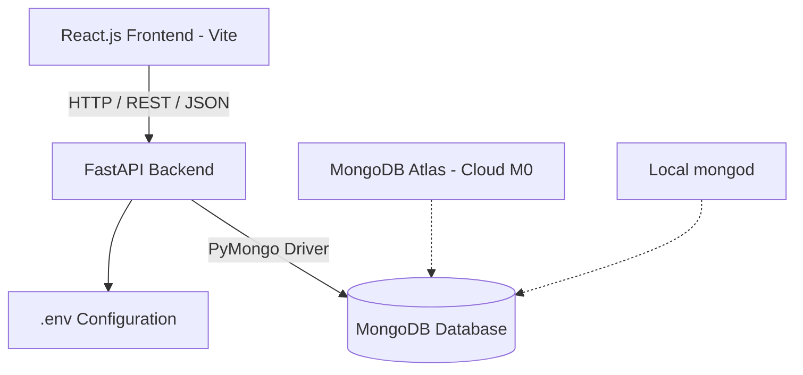
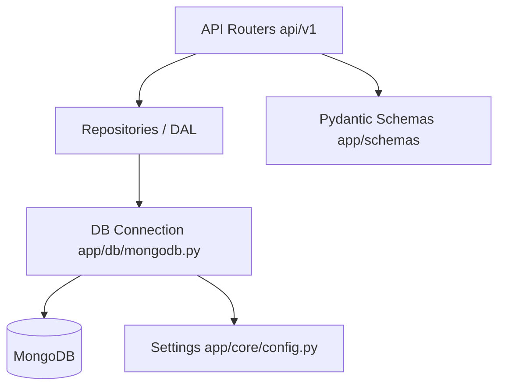
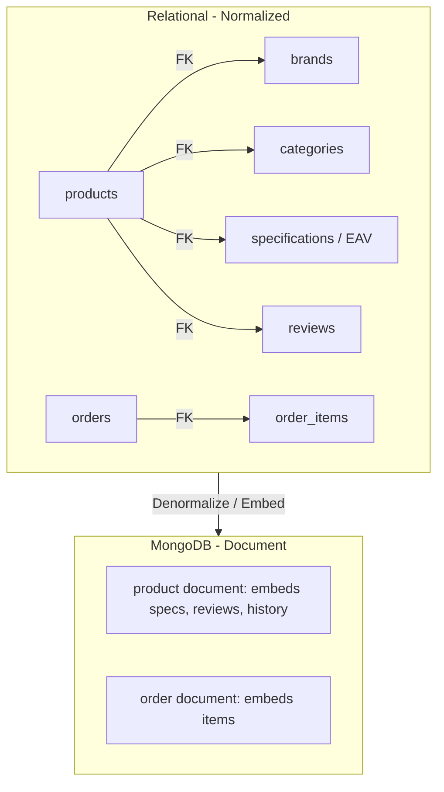

# Project Report

## ElectroHub — NoSQL E-Commerce Catalog

| | |
|---|---|
| **Course** | Advanced Business Applications (ABA) |
| **Subject** | NoSQL Databases |
| **Project Title** | ElectroHub — A Document-Based Electronics Catalog |
| **Technology Stack** | FastAPI (Python) · MongoDB · React.js (Vite) |
| **Prepared By** | [Student Name] |
| **Roll / Reg. No.** | [Roll Number] |
| **Institution** | [Institution Name] |
| **Date** | [DD-MM-YYYY] |

---

## Abstract

ElectroHub is a full-stack consumer-electronics catalog built to demonstrate practical NoSQL
database design with MongoDB. The system models an online catalog — products, brands,
categories, users, carts, wishlists and orders — as MongoDB documents rather than normalized
relational tables. Using the PyMongo driver directly (no ODM) through a clean
Repository/DAL pattern, the backend exposes a RESTful JSON API (FastAPI) that the React
frontend consumes.

The project specifically exercises core NoSQL concepts: **embedding vs. referencing** of
related data, **denormalization** for read performance, **flexible/schemaless documents** for
varied product specifications, and **aggregation-pipeline** based search, filtering, sorting and
pagination. It supports both a local MongoDB instance and a cloud MongoDB Atlas cluster, ships
with a seed dataset (12 products, 4 categories, 8 brands), and passes a suite of **23 automated
API tests**.

---

## Table of Contents

1. [Introduction](#1-introduction)
2. [Technology Stack & Justification](#2-technology-stack--justification)
3. [System Architecture](#3-system-architecture)
4. **NoSQL Database Design** — [collections](#41-database-overview), [schemas](#42-document-schemas), [embedding vs referencing](#44-embedding-vs-referencing-decisions), [indexes](#45-indexing-strategy), [aggregation](#46-aggregation-and-query-design), [integrity](#47-data-integrity-and-consistency)
5. [NoSQL vs Relational (SQL) Comparison](#5-nosql-vs-relational-sql-comparison)
6. [Backend / REST API Design](#6-backend--rest-api-design)
7. [Security Implementation](#7-security-implementation)
8. [Frontend Application](#8-frontend-application)
9. [Sample Dataset (Seed)](#9-sample-dataset-seed)
10. [Testing & Quality Assurance](#10-testing--quality-assurance)
11. [Deployment](#11-deployment)
12. [Results & Demonstration](#12-results--demonstration)
13. [Challenges, Limitations & Learning Outcomes](#13-challenges-limitations--learning-outcomes)
14. [Conclusion & Future Scope](#14-conclusion--future-scope)
15. [Appendix A — Module Map](#appendix-a--module-map)
16. [Appendix B — Setup & Commands](#appendix-b--setup--commands)
17. [Appendix C — Representative MongoDB Queries](#appendix-c--representative-mongodb-queries)

---

## 1. Introduction

### 1.1 Background
Traditional e-commerce data (products, categories, orders) is frequently modelled in a relational
database. However, product catalogs have **heterogeneous attributes** — a smartphone has RAM and
battery specs, a television has screen size and refresh rate, headphones have ANC profiles. In a
rigid relational schema this forces either wide sparse tables or expensive entity-attribute-value
(EAV) tables. MongoDB's document model absorbs this variability naturally by storing
per-product specifications as an array of flexible key/value sub-documents.

### 1.2 Problem Statement
Design and implement a full-stack electronics catalog that:
1. Demonstrates **document-based data modelling** and the NoSQL design trade-offs.
2. Supports rich read operations — search, filter, sort, paginate — over catalog data.
3. Maintains transactional integrity for cart and order flows.
4. Integrates cleanly across frontend, REST API, and database layers.

### 1.3 Objectives
- Apply NoSQL concepts (embedding, referencing, denormalization, indexing, aggregation).
- Build a functional full-stack application (React + FastAPI + MongoDB).
- Showcase CRUD operations across multiple collections.
- Compare the document model against a relational equivalent.
- Deliver a demonstrable, documented project.

### 1.4 Scope
**In scope:** product catalog with search/filter/sort/pagination; product detail with
specifications, reviews and price history; category/brand filtering; user authentication (JWT);
cart, wishlist and comparison (up to 4); review submission with live rating recalculation; order
placement with stock decrement and order history; dual support for local MongoDB and Atlas.

**Out of scope:** real payment gateway, multi-vendor support, admin analytics, and advanced
inventory management beyond stock tracking.

---

## 2. Technology Stack & Justification

| Layer | Technology | Version | Justification |
|---|---|---|---|
| Database | **MongoDB** | — | Document store; flexible schema; the subject of study |
| Driver | **PyMongo** | — | Direct driver control — makes raw MongoDB usage explicit (no ODM abstraction) |
| Backend | **FastAPI** | — | Async, typed, auto-generated OpenAPI/Swagger docs |
| Validation | **Pydantic v2** | — | Request/response schemas with automatic validation |
| Auth | **PyJWT + bcrypt** | — | Stateless JWT bearer tokens; bcrypt password hashing |
| Frontend | **React 19 + Vite 8** | 19.2 / 8.3 | Component-based SPA, fast HMR and build |
| Styling | **Tailwind CSS v4** | 4.3 | Utility-first styling with themable design tokens |
| Routing | **React Router 7** | 7.18 | Client-side routing |
| HTTP client | **Axios** | 1.20 | Promise-based API calls with interceptors |
| Motion/UX | **Motion, Lenis, GSAP** | 14 / 1.3 / 3.15 | Reveals, smooth scroll, transitions |
| Icons | **lucide-react** | 1.57 | Consistent icon set |
| Testing | **pytest + httpx** | — | API-level integration tests via `TestClient` |

---

## 3. System Architecture

A clean **three-tier architecture** with strict separation of concerns.



### 3.1 Backend layered architecture
The backend follows the **Repository / DAL pattern**, keeping routing, validation and data access
separated:



- **Routers** (`app/api/v1/`) — HTTP concerns only (status codes, dependencies, query params).
- **Repositories** (`app/repositories/`) — all MongoDB reads/writes; one class per collection.
- **Schemas** (`app/schemas/`) — Pydantic models for validation and serialization.
- **Core** (`app/core/`) — configuration (`config.py`) and security (`security.py`).
- **Utils** (`app/utils/serialization.py`) — recursive BSON → JSON conversion (`ObjectId` → str,
  `datetime` → ISO-8601).

### 3.2 Connection management
`app/db/mongodb.py` lazily creates a single shared `MongoClient` (singleton) and exposes
`get_db()`. The client is closed on application shutdown via FastAPI's lifespan hook.

```python
def get_db() -> Database:
    global _db
    if _db is None:
        _db = get_client()[settings.MONGODB_DB_NAME]
    return _db
```

### 3.3 Environment switching
`app/core/config.py` selects the connection URI based on the `ENV` variable (`local` | `atlas`),
allowing the same codebase to run offline or against a cloud cluster without changes:

```python
@property
def mongo_uri(self) -> str:
    return self.MONGODB_URI_ATLAS if self.ENV.lower() == "atlas" else self.MONGODB_URI_LOCAL
```

---

## 4. NoSQL Database Design

This is the core of the project.

### 4.1 Collections

Database name: **`electrohub`** (configurable). Seven collections are used:

| Collection | Purpose | Modelling approach |
|---|---|---|
| `products` | Core catalog entity — read-heavy | **Embeds** specifications, reviews, price history; **references** brand & category (denormalized ref) |
| `brands` | Brand master data | Standalone; referenced by products |
| `categories` | Category master data | Standalone; referenced by products |
| `users` | Account + auth data | Standalone; unique email/username |
| `orders` | Order history | **Embeds** line items (snapshots) |
| `carts` | Per-user cart (session-like) | One document per user; **embeds** item array |
| `wishlists` | Per-user wishlist | One document per user; array of product id refs |

> **Note on reviews:** although a `reviews` collection exists as a drop target during seeding,
> reviews are actually **embedded inside each product document** as a sub-document array. This is
> a deliberate embedding decision (see §4.4) since reviews are always displayed with their product.

### 4.2 Document Schemas

**Product document** (embeds specs, reviews, price history; references brand/category):

```json
{
  "_id": "ObjectId('...')",
  "slug": "samsung-galaxy-s24",
  "name": "Samsung Galaxy S24",
  "brand":    { "_id": "ObjectId('...')", "name": "Samsung",  "slug": "samsung" },
  "category": { "_id": "ObjectId('...')", "name": "Smartphones", "slug": "smartphones" },
  "description": "Compact flagship with a 6.2-inch Dynamic AMOLED 2X display...",
  "price": 79999,
  "discount_price": 62999,
  "stock": 15,
  "images": ["url1", "url2", "url3"],
  "image": "url1",
  "specifications": [
    { "key": "Display",   "value": "6.2-inch Dynamic AMOLED 2X, 120Hz" },
    { "key": "Processor", "value": "Snapdragon 8 Gen 3" },
    { "key": "RAM",       "value": "8 GB" }
  ],
  "reviews": [
    { "user_id": "...", "username": "demo", "rating": 5,
      "comment": "Excellent camera and battery life.", "created_at": "ISODate(...)" }
  ],
  "price_history": [
    { "old_price": 79999, "new_price": 62999, "changed_at": "ISODate(...)" }
  ],
  "average_rating": 4.5,
  "total_reviews": 2,
  "is_active": true,
  "is_featured": true,
  "created_at": "ISODate(...)",
  "updated_at": "ISODate(...)"
}
```

**Cart document** (one per user, embedded items with product snapshot):

```json
{
  "_id": "ObjectId('...')",
  "user_id": "ObjectId('...')",
  "items": [
    { "product_id": "...", "slug": "samsung-galaxy-s24", "name": "Samsung Galaxy S24",
      "image": "...", "price": 79999, "discount_price": 62999, "stock": 15, "quantity": 2 }
  ],
  "updated_at": "ISODate(...)"
}
```

**Wishlist document:** `{ "user_id": "...", "product_ids": ["...", "..."], "updated_at": ... }`

**Order document** (embedded line items, immutable snapshot at checkout):

```json
{
  "_id": "ObjectId('...')",
  "user_id": "...",
  "items": [ { "product_id": "...", "name": "...", "price": 79999, "quantity": 1 } ],
  "subtotal": 79999, "discount": 17000, "total": 62999,
  "status": "pending",
  "created_at": "ISODate(...)"
}
```

**User document:** `{ "name", "username", "email", "password" (bcrypt hash), "is_active", "created_at" }`

### 4.3 Design philosophy
- **Embedding vs referencing** chosen per access pattern, not normalization rules.
- **Denormalization for read performance** — brand/category names are copied into each product so
  listing pages never need a join/lookup.
- **Flexible schema** — `specifications` is a generic key/value array, so different product types
  carry different attributes in the same collection.
- **Avoiding unnecessary joins** — related, frequently-co-read data lives in the same document.

### 4.4 Embedding vs Referencing Decisions

| Relationship | Decision | Rationale |
|---|---|---|
| product → specifications | **Embed** | Always shown with product; small; shape varies by product type |
| product → reviews | **Embed** | Displayed on the product page; read together |
| product → price_history | **Embed** | Bounded; rendered alongside the product |
| product → brand / category | **Reference (denormalized)** | Store `_id` for integrity + copy `name`/`slug` for display, avoiding a lookup per product |
| cart → items | **Embed** | Session-like, one document per user, no cross-document transactions needed |
| order → items | **Embed** | Order is an immutable snapshot; items belong exclusively to it |
| user → wishlist | **Array of refs** | Lightweight; product details resolved at read time |
| users ↔ orders | **Reference** | Unbounded growth; orders queried independently by `user_id` |

### 4.5 Indexing Strategy

Indexes created during seeding (`seed.py`):

| Collection | Index | Type | Purpose |
|---|---|---|---|
| `products` | `slug` | **Unique** | Fast detail lookup by slug; enforce uniqueness |
| `products` | `name` | Regular | Sorting/matching on name |
| `products` | `brand._id` | Regular | Filter by brand |
| `products` | `category._id` | Regular | Filter by category |
| `products` | `price` | Regular | Price sort/range |
| `products` | `is_active` | Regular | Filter active products |
| `users` | `email` | **Unique** | Auth lookup; prevent duplicates |
| `users` | `username` | **Unique** | Auth lookup; prevent duplicates |
| `brands` | `slug` | **Unique** | Brand lookup |
| `categories` | `slug` | **Unique** | Category lookup |

### 4.6 Aggregation and Query Design

Product listing uses a single **aggregation pipeline** to combine search, filtering, a computed
"effective price", sorting, pagination and total count in one round-trip:

```javascript
db.products.aggregate([
  { $match: { is_active: true, /* q / category / brand criteria */ } },
  { $addFields: { effective_price: { $ifNull: ["$discount_price", "$price"] } } },
  { $match: { effective_price: { $gte: min, $lte: max } } },   // price range
  { $sort: { effective_price: 1 } },                            // or newest / rating
  { $facet: {
      items: [ { $skip: skip }, { $limit: limit },
               { $project: { specifications: 0, reviews: 0, price_history: 0 } } ],
      total: [ { $count: "count" } ]
  }}
])
```

Key points:
- **`$facet`** returns page items **and** the total count in one query — no second count call.
- **`$addFields` + `$ifNull`** computes the effective (discounted) price for correct sorting and
  range filtering.
- **`$project`** excludes heavy arrays (`specifications`, `reviews`, `price_history`) from list
  responses, keeping payloads small — a document-model performance consideration.
- **Search (`q`)** matches across name, brand, category **and embedded specification values** in a
  single document query (no joins).
- **Reviews** are appended with `$push` and the aggregate rating recomputed in the same update.

### 4.7 Data Integrity and Consistency
- **Uniqueness** enforced via unique indexes on `slug`, `email`, `username`.
- **Referential integrity** managed in the repository layer (e.g. validating a `product_id` exists
  before adding to cart; `ObjectId.is_valid()` guards malformed ids).
- **Stock consistency** — order creation validates stock, decrements it, and builds the order from
  the cart in one flow; empty carts are rejected.
- **Snapshots** — cart items and order items capture price/name at the time of addition, so later
  catalog price changes do not silently alter an in-progress cart or a placed order.

---

## 5. NoSQL vs Relational (SQL) Comparison



| Aspect | Relational (SQL) | MongoDB (this project) |
|---|---|---|
| Product specs | EAV table or wide sparse table | Flexible `specifications` array per document |
| Fetching a product page | Multiple JOINs (product + brand + category + specs + reviews) | **Single document read** |
| Adding a new attribute | Schema migration (`ALTER TABLE`) | Just write the field — schema-flexible |
| Listing with total count | `SELECT` + `SELECT COUNT(*)` | Aggregation `$facet` in one query |
| Referential integrity | Enforced by DB (FK constraints) | Enforced in application layer |
| Transactions | Native, multi-table | Single-document atomicity; app-level coordination |
| Best fit | Highly relational, strict-integrity data | Read-heavy, variable-shaped catalog data |

**Trade-off summary:** MongoDB trades some referential guarantees and normalization for read
performance, schema flexibility and simpler code paths for hierarchical data. ElectroHub is
read-heavy and heterogeneous, which suits the document model well.

### 5.1 Local vs Atlas
| Aspect | Local MongoDB | MongoDB Atlas (M0) |
|---|---|---|
| Connectivity | `mongodb://localhost:27017` | `mongodb+srv://` with auth |
| Security | Basic (local machine) | IP whitelist + DB users + TLS |
| Use case | Development / offline | Sharing, demo, cloud backup |
| Trade-off | Needs `mongod` running | Needs internet; free-tier limits |

---

## 6. Backend / REST API Design

Base URL: `/api/v1`. All endpoints return JSON. Auth-protected routes require
`Authorization: Bearer <token>`.

| Method | Endpoint | Auth | Description |
|---|---|---|---|
| GET | `/products/` | — | List products (`q`, `category`, `brand`, `min_price`, `max_price`, `sort`, `page`, `limit`) |
| GET | `/products/featured` | — | Featured products by rating |
| GET | `/products/{slug}` | — | Product detail (full document) |
| GET | `/products/{slug}/related` | — | Related products in same category |
| POST | `/products/{slug}/reviews` | ✅ | Add a review; recomputes average rating |
| GET | `/categories/` | — | List categories |
| GET | `/brands/` | — | List brands |
| POST | `/auth/register` | — | Register (201) — returns token |
| POST | `/auth/login` | — | Login — returns token |
| GET | `/auth/me` | ✅ | Current user profile |
| GET | `/cart/` | ✅ | Get cart with computed subtotal/discount/total |
| POST | `/cart/add` | ✅ | Add item (stock-capped) |
| PUT | `/cart/update` | ✅ | Update quantity (0 removes) |
| DELETE | `/cart/remove/{product_id}` | ✅ | Remove item |
| DELETE | `/cart/clear` | ✅ | Empty cart |
| GET | `/wishlist/` | ✅ | Get wishlist (resolved product docs) |
| POST | `/wishlist/add` | ✅ | Add to wishlist |
| DELETE | `/wishlist/remove/{product_id}` | ✅ | Remove from wishlist |
| POST | `/orders/` | ✅ | Place order from cart (201); decrements stock |
| GET | `/orders/` | ✅ | Order history for current user |
| GET | `/` | — | Health/root banner |
| GET | `/health` | — | Health check |

Interactive documentation is auto-served by FastAPI at `/docs` (Swagger UI) and `/redoc`.

---

## 6.1 Repository Layer

Business/data logic lives in one repository class per collection:

`ProductRepository`, `CategoryRepository`, `BrandRepository`, `UserRepository`,
`CartRepository`, `WishlistRepository`, `OrderRepository`.

Example — product listing delegates all MongoDB work to the repository while the router stays
thin:

```python
@router.get("/")
def list_products(q=None, category=None, brand=None, min_price=None,
                  max_price=None, sort="newest", page=1, limit=12):
    return ProductRepository().list_products(
        q, category, brand, min_price, max_price, sort, page, limit
    )
```

---

## 7. Security Implementation

| Concern | Implementation |
|---|---|
| Password storage | **bcrypt** hash with per-password salt (`hash_password`) |
| Authentication | **JWT** (HS256) bearer tokens signed with `SECRET_KEY` |
| Token lifetime | Configurable `ACCESS_TOKEN_EXPIRE_MINUTES` (default 1440 = 24 h) |
| Authorization | `get_current_user` dependency validates token, resolves `ObjectId`, loads user |
| Password exposure | `public_user()` strips the `password` field from all responses |
| Input validation | Pydantic schemas enforce types, lengths, email format, rating 1–5 |
| CORS | Allow-list from `CORS_ORIGINS` (dev: localhost:5173) |
| Type safety | `ObjectId.is_valid()` guards prevent malformed-id injection |

Protected routes declare `user: dict = Depends(get_current_user)`; missing/invalid tokens yield
`401 Unauthorized`.

---

## 8. Frontend Application

React 19 SPA (Vite) consuming the REST API via an Axios instance with a base URL from
`VITE_API_URL` (falls back to `/api/v1` via the Vite dev proxy). A response interceptor rejects
non-JSON responses, and an `ErrorBoundary` renders a graceful error panel instead of a blank page.

**Pages:** Home, Products (search/filter/sort/paginate), Product Detail (specs, reviews, price
history, related), Categories/Brands browsing, Cart, Wishlist, Compare (up to 4), Login, Register,
and Orders.

**Design system:** a terminal-inspired UI with a dark "MongoDB Forest" theme (neon-green on forest
black), monospace typography, CRT scanline texture, and motion-driven reveals (Motion, Lenis smooth
scroll, GSAP).

---

## 9. Sample Dataset (Seed)

`seed.py` drops and recreates the collections, then inserts:

| Entity | Count | Details |
|---|---|---|
| Categories | 4 | Smartphones, Laptops, Televisions, Headphones |
| Brands | 8 | Apple, Samsung, OnePlus, Dell, ASUS, Sony, LG, Bose |
| Products | 12 | Across all 4 categories, with embedded specs/reviews/price history |
| Embedded reviews | 14 | Ratings 4–5 across products |
| Price-history records | 8 | Tracked price drops |
| Sample user | 1 | `demo@example.com` / `demo12345` |

Realistic INR pricing and current flagship device data are used for a credible demonstration.

---

## 10. Testing & Quality Assurance

**Backend:** 23 integration tests via `pytest` + FastAPI `TestClient`, run against a seeded
database (a session fixture reseeds before and after the run).

| Test module | Tests | Coverage |
|---|---|---|
| `test_products.py` | 11 | Listing, search, category/brand filter, price range, sort, pagination, detail, 404, featured/related, categories & brands |
| `test_auth.py` | 5 | Login success/failure, auth-required, register + duplicate, validation |
| `test_cart_orders.py` | 7 | Cart auth, cart CRUD, wishlist toggle, review + rating update, review validation, order flow with stock decrement, empty-cart rejection |

**Frontend:** linting via **oxlint** (`npm run lint`).

Result: **23/23 backend tests passing**; frontend builds and lints cleanly.

---

## 11. Deployment

| Component | Target | Notes |
|---|---|---|
| Frontend | **Netlify** | `netlify.toml` (base `frontend`, build `npm run build`, publish `dist`); SPA redirect via `_redirects`; `VITE_API_URL` env var |
| Backend | **Render** (or any ASGI host) | `uvicorn app.main:app`; env: `ENV=atlas`, `MONGODB_URI_ATLAS`, `CORS_ORIGINS` |
| Database | **MongoDB Atlas** (M0) | Managed cloud cluster; IP allow-list + DB user |
| Local dev | Local `mongod` | `ENV=local`, `mongodb://localhost:27017` |

The single `ENV` switch means local development and cloud deployment share identical code.

---

## 12. Results & Demonstration

- **Search & discovery:** free-text search across names, brands, categories and specification
  values returns results in a single indexed document query.
- **Filtering & sorting:** category, brand and price-range filters combine with price/rating/newest
  sorting and pagination; the aggregation `$facet` returns items plus total in one round-trip.
- **Product detail:** full document read renders specifications, reviews and price history without
  joins.
- **Accounts:** registration/login return JWT tokens; protected actions resolve the current user.
- **Cart & checkout:** adding items respects stock caps; checkout validates stock, decrements it,
  creates an order snapshot and clears the cart.
- **NoSQL techniques demonstrated:** embedding, denormalized references, flexible schemas,
  aggregation pipelines, and purpose-built indexes.

---

## 13. Challenges, Limitations & Learning Outcomes

**Challenges addressed**
- Balancing embedding vs referencing (e.g. embedding reviews but referencing users/orders).
- Keeping list responses light by projecting out heavy embedded arrays.
- Computing the discounted "effective price" for correct sort/range via `$addFields`.
- Modelling session-like cart state as a per-user document.

**Limitations**
- Order/stock operations are **not** wrapped in a multi-document transaction; consistency is
  enforced at the application layer.
- No real payment processing.
- Reviews are embedded, which caps practical review volume per product.

**Learning outcomes**
- Practical MongoDB schema design and trade-off analysis.
- Aggregation-pipeline authoring (`$match`, `$addFields`, `$sort`, `$facet`, `$project`).
- Index design for query performance and uniqueness.
- JWT-based auth and secure password storage.
- Full-stack integration with REST and typed validation.

---

## 14. Conclusion & Future Scope

The project successfully delivers a working, documented, full-stack electronics catalog that
demonstrates the core principles of NoSQL database design using MongoDB. The document model
proved a natural fit for a heterogeneous catalog: flexible specifications, denormalized brand and
category references, and embedded reviews/price history eliminated joins while keeping reads fast.

**Future scope:**
- Multi-document transactions for atomic checkout.
- MongoDB Atlas Search / text indexes for advanced full-text search.
- Time-series collection for price history and trend analytics.
- Admin dashboard for catalog management.
- Pagination of reviews and a separate reviews collection at scale.

---

## Appendix A — Module Map

```text
Electronics-Catalog/
├── backend/
│   ├── app/
│   │   ├── api/v1/          # Routers: auth, brands, cart, categories, orders, products, wishlist
│   │   ├── core/            # config.py (settings), security.py (JWT + bcrypt)
│   │   ├── db/              # mongodb.py (shared client / get_db)
│   │   ├── repositories/    # DAL: product, brand, category, user, cart, wishlist, order
│   │   ├── schemas/         # Pydantic models: auth, product, cart
│   │   ├── utils/           # serialization.py (BSON → JSON)
│   │   └── main.py          # FastAPI app + CORS + router registration
│   ├── tests/               # conftest + 23 pytest cases
│   ├── seed.py              # sample data + indexes
│   └── requirements.txt
├── frontend/
│   ├── src/
│   │   ├── pages/           # Home, Products, ProductDetail, Cart, Wishlist, Compare, Login, ...
│   │   ├── components/      # UI components, layout, error boundary
│   │   ├── context/         # auth / cart / wishlist state
│   │   └── services/api.js  # axios instance
│   └── netlify.toml
├── docs/                    # 13 design documents
├── implementation/          # 8 phase guides
├── BRD.md                   # Business Requirements Document
└── PROJECT-REPORT.md        # this report
```

## Appendix B — Setup & Commands

**Backend**
```bash
cd backend
python -m venv .venv
.venv\Scripts\activate            # Windows  (source .venv/bin/activate on Unix)
pip install -r requirements.txt
cp .env.example .env              # set ENV=local|atlas and MongoDB URI
python seed.py                    # seed sample data
uvicorn app.main:app --reload --port 8000
```
- API: http://localhost:8000/api/v1 · Swagger: http://localhost:8000/docs

**Frontend**
```bash
cd frontend
npm install
npm run dev                       # http://localhost:5173 (proxies /api → :8000)
```

**Tests / lint**
```bash
cd backend && pytest
cd frontend && npm run lint
```

## Appendix C — Representative MongoDB Queries

```javascript
// 1. Search across product, brand, category and embedded specs
db.products.find({
  is_active: true,
  $or: [
    { name: /galaxy/i },
    { "brand.name": /samsung/i },
    { "category.name": /smartphones/i },
    { "specifications.value": /snapdragon/i }
  ]
})

// 2. Active products with a discount, cheapest first
db.products.find({ is_active: true, discount_price: { $ne: null } })
           .sort({ discount_price: 1 })

// 3. Category counts (aggregation)
db.products.aggregate([
  { $match: { is_active: true } },
  { $group: { _id: "$category.name", products: { $sum: 1 } } },
  { $sort: { products: -1 } }
])

// 4. Average rating per brand (embedded array + unwind)
db.products.aggregate([
  { $unwind: "$reviews" },
  { $group: { _id: "$brand.name", avg_rating: { $avg: "$reviews.rating" } } },
  { $sort: { avg_rating: -1 } }
])
```

## Appendix C (cont.) — Representative API Calls

```bash
# Login and capture token
curl -s -X POST http://localhost:8000/api/v1/auth/login \
  -H "Content-Type: application/json" \
  -d '{"email":"demo@example.com","password":"demo12345"}'

# Search + filter + sort + paginate
curl "http://localhost:8000/api/v1/products/?q=samsung&category=smartphones&max_price=100000&sort=price_asc&page=1&limit=12"

# Add to cart (authenticated)
curl -X POST http://localhost:8000/api/v1/cart/add \
  -H "Authorization: Bearer <TOKEN>" -H "Content-Type: application/json" \
  -d '{"product_id": "<id>", "quantity": 1}'
```

---

*End of report.*
