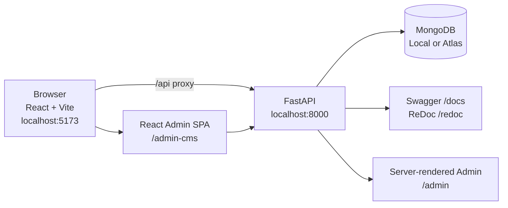
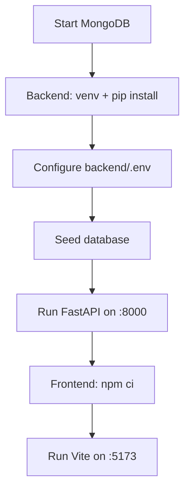

# ElectroHub

<p align="center">
  <strong>Full-stack consumer-electronics catalog</strong><br/>
  <em>FastAPI + MongoDB + React/Vite, with a terminal-inspired UI and a dual Admin CMS.</em>
</p>

<p align="center">
  
  
  
  
  
  
  
</p>

> Browse, search, compare, and track price history across a curated range of smartphones, laptops,
> audio, and displays. Includes a full admin CMS, JWT auth, cart, wishlist, comparison, reviews, and
> order management.

## Architecture



The frontend proxies `/api` to the backend during local development, so no CORS configuration is
needed. The backend exposes the public catalog API and the shared admin JSON API at `/api/v1/admin/*`.

## Stack

| Layer | Stack |
|---|---|
| Frontend | React 19, Vite 8, Tailwind CSS 4, React Router |
| Motion & UX | Motion (Framer Motion), GSAP, Lenis smooth scroll |
| Backend | FastAPI, Pydantic v2, PyMongo, Uvicorn |
| Database | MongoDB (local or Atlas) |
| Auth | JWT access tokens |
| Admin | FastAPI/Jinja2 server-rendered CMS + React SPA |
| API docs | Swagger UI and ReDoc |

## Feature Highlights

- Product catalog with search, filtering, sorting, and pagination
- Product details with specifications, reviews, and price history
- Category and brand filtering
- User authentication with register/login and JWT
- Shopping cart, wishlist, and product comparison for up to 4 products
- Reviews with live rating recalculation
- Order placement with stock decrement and order history
- Dual admin CMS: server-rendered `/admin` and React SPA `/admin-cms`
- RESTful API with Swagger documentation
- Document-based data modeling with MongoDB local/Atlas support
- Terminal-inspired UI: MongoDB Forest theme, CRT scanlines, mono type, and motion-driven reveals

## Project Structure

```text
Electronics-Catalog/
├── backend/
│   ├── app/
│   │   ├── admin/          # Server-rendered admin CMS
│   │   ├── api/v1/         # Public and admin JSON APIs
│   │   ├── core/           # Settings and security
│   │   ├── db/             # MongoDB connection
│   │   ├── repositories/   # Data access layer
│   │   ├── schemas/        # Pydantic schemas
│   │   └── services/       # Business logic
│   ├── tests/              # 56 backend tests
│   ├── seed.py             # Sample data + admin account
│   └── requirements.txt
├── frontend/
│   ├── src/                # React app + admin SPA
│   ├── package.json
│   └── vite.config.js
├── docs/                   # Project documentation
├── implementation/         # Phase-wise implementation guides
├── netlify.toml
├── render.yaml
├── vercel.json
└── AGENTS.md
```

## Quick Start

### 1. Start MongoDB

Choose local MongoDB or MongoDB Atlas. See
[docs/11-deployment-plan.md](docs/11-deployment-plan.md).

### 2. Backend

```bash
cd backend
python -m venv .venv
.venv\Scripts\activate        # Windows
pip install -r requirements.txt
cp .env.example .env
# Fill ENV, MongoDB URI, SECRET_KEY, ADMIN_EMAIL, ADMIN_PASSWORD
python seed.py                # Seed sample data (12 products, 4 categories, 8 brands)
uvicorn app.main:app --reload --port 8000
```

### 3. Frontend

```bash
cd frontend
npm ci
npm run dev
```

The Vite dev server proxies `/api` to `http://localhost:8000`.



## Access

| Service | URL |
|---|---|
| Frontend | http://localhost:5173 |
| API | http://localhost:8000/api/v1 |
| Swagger UI | http://localhost:8000/docs |
| ReDoc | http://localhost:8000/redoc |
| Server-rendered admin | http://localhost:8000/admin |
| React admin SPA | http://localhost:5173/admin-cms |

## Environment Variables

| Variable | Purpose |
|---|---|
| `ENV` | Select `local` or `atlas` MongoDB connection |
| `MONGODB_URI_LOCAL` | Local MongoDB connection URI |
| `MONGODB_URI_ATLAS` | MongoDB Atlas SRV URI |
| `MONGODB_DB_NAME` | Database name |
| `API_V1_PREFIX` | API route prefix |
| `CORS_ORIGINS` | Allowed frontend origins |
| `SECRET_KEY` | JWT signing key |
| `ACCESS_TOKEN_EXPIRE_MINUTES` | JWT lifetime in minutes |
| `ADMIN_EMAIL` / `ADMIN_PASSWORD` | Admin account created by the seed script |

Use `backend/.env.example` as the template. Do not commit `backend/.env` or `frontend/.env`.

## Admin CMS

The admin layer has two peers sharing one backend:

- **Server-rendered CMS** at `/admin` — FastAPI + Jinja2, HttpOnly `admin_session` cookie, CSRF
  double-submit, form POST + PRG.
- **React SPA** at `/admin-cms` — Bearer token stored in
  `localStorage['electrohub_admin_token']`, calling the JSON API.
- **Shared JSON API** at `/api/v1/admin/*` — auth, stats, products, categories, brands, orders, and
  reviews.

See [AGENTS.md](AGENTS.md) for the admin architecture and authorization rules.

## Reinstall Dependencies

Generated dependency/build folders are intentionally not committed. To recreate them:

```bash
# Backend (local; tested with Python 3.14.3)
cd backend
python -m venv .venv
.venv\Scripts\activate
pip install -r requirements.txt

# Frontend
cd frontend
npm ci
```

Keep `backend/.env` and `frontend/.env`; if either is missing, copy its `.env.example` and fill the
required values. `backend/.python-version` pins Python 3.12 for Render deployment; 3.14.3 was used
for the local `.venv`.

## Sample Account

| Field | Value |
|---|---|
| Email | `demo@example.com` |
| Username | `demo` |
| Password | `demo12345` |

## Testing

Backend tests use `pytest` (56 tests covering catalog, auth, cart, wishlist, reviews, and orders):

```bash
cd backend
.venv\Scripts\activate
pytest
```

Frontend lint:

```bash
cd frontend
npm run lint
```

## Deployment

| Target | Guide |
|---|---|
| Frontend on Netlify | [docs/12-netlify-deployment.md](docs/12-netlify-deployment.md) |
| Backend + MongoDB Atlas on Render | [docs/13-backend-and-atlas-deployment.md](docs/13-backend-and-atlas-deployment.md) |
| General deployment plan | [docs/11-deployment-plan.md](docs/11-deployment-plan.md) |

Ready-to-use deployment files: [`netlify.toml`](netlify.toml), [`render.yaml`](render.yaml), and
[`vercel.json`](vercel.json).

## Documentation

| Document | Description |
|---|---|
| [BRD](BRD.md) | Business Requirements Document |
| [Product Vision](docs/01-product-vision.md) | Product direction and goals |
| [MVP Scope](docs/02-mvp-scope.md) | Minimum viable scope |
| [PRD](docs/03-product-requirements.md) | Product requirements |
| [User Flows](docs/04-user-flows.md) | User journeys |
| [UI/UX Design](docs/05-ui-ux-design.md) | Interface and interaction design |
| [Software Architecture](docs/06-software-architecture.md) | System architecture |
| [Database Design](docs/07-database-design.md) | NoSQL data model |
| [API Spec (OpenAPI YAML)](docs/08-api-specification.yaml) | Machine-readable API spec |
| [API Spec (Markdown)](docs/api-specification.md) | Human-readable API spec |
| [Development Roadmap](docs/09-development-roadmap.md) | Phase-based roadmap |
| [Test Plan](docs/10-test-plan.md) | Testing strategy |
| [Deployment Plan](docs/11-deployment-plan.md) | Local and cloud deployment |
| [Netlify Deployment](docs/12-netlify-deployment.md) | Frontend deployment |
| [Backend + Atlas](docs/13-backend-and-atlas-deployment.md) | Render + MongoDB Atlas deployment |

## Implementation Phases

The build is organized into **8 sequential phases** with clear tasks and exit criteria. See
[docs/09-development-roadmap.md](docs/09-development-roadmap.md).

| Phase | Guide |
|---|---|
| 1 | [Foundation & Environment](implementation/phase-01-foundation-setup.md) |
| 2 | [Data Layer: Modeling & Seeding](implementation/phase-02-data-layer.md) |
| 3 | [Backend Core API](implementation/phase-03-backend-core-api.md) |
| 4 | [Frontend Core UI](implementation/phase-04-frontend-core.md) |
| 5 | [Auth](implementation/phase-05-auth.md) |
| 6 | [Cart, Wishlist & Compare](implementation/phase-06-cart-wishlist-compare.md) |
| 7 | [Reviews & Checkout](implementation/phase-07-reviews-checkout.md) |
| 8 | [Testing & Deployment](implementation/phase-08-testing-deployment.md) |

## License

Released for educational use. See [BRD.md](BRD.md) and the `docs/` folder for full product
documentation and academic context.
