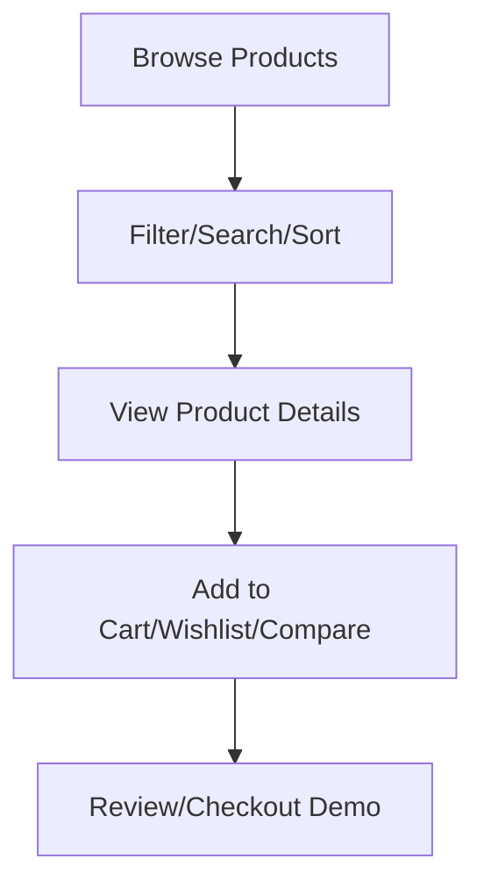

# 2. MVP Scope

## MVP Definition
Minimum Viable Product includes core features to demonstrate MongoDB usage and full-stack functionality.

## Core Features (Must Have)

| Feature | Priority | Description |
|---|---|---|
| Product Listing | P0 | Display all products with basic info |
| Product Search | P0 | Search by name, brand, description |
| Category/Brand Filter | P0 | Filter products |
| Price Range Filter | P0 | Filter by price range |
| Sorting | P0 | Sort by price, rating, newest |
| Product Details | P0 | View full product info, specs, reviews |
| MongoDB CRUD | P0 | All data from MongoDB |
| REST API | P0 | FastAPI endpoints |
| Frontend UI | P0 | React components |

## Nice to Have (If Time Permits)

| Feature | Priority | Description |
|---|---|---|
| User Auth | P1 | Signup/Login |
| Cart | P1 | Add/Update/Remove |
| Wishlist | P1 | Save products |
| Comparison | P1 | Compare up to 4 products |
| Reviews | P1 | Add reviews |
| Price History | P2 | Display chart |

