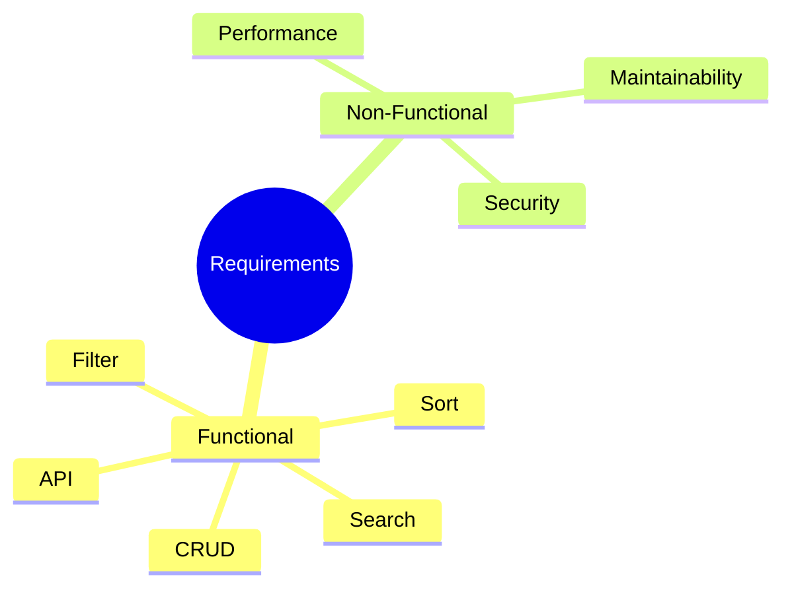

# 3. Product Requirements

## 3.1 Functional Requirements

| ID | Requirement | Priority |
|---|---|---|
| FR-001 | System shall display list of active products from MongoDB | P0 |
| FR-002 | Users can search products by name/brand/description | P0 |
| FR-003 | Users can filter by category, brand, price range | P0 |
| FR-004 | Users can sort by price (asc/desc), rating, newest | P0 |
| FR-005 | System shall show product details with specs/reviews | P0 |
| FR-006 | API endpoints must follow REST conventions | P0 |
| FR-007 | All data operations use MongoDB | P0 |
| FR-008 | Pagination for product list | P0 |
| FR-009 | User registration & login | P1 |
| FR-010 | Add/remove/update cart items | P1 |

## 3.2 Non-Functional Requirements

| ID | Requirement | Priority |
|---|---|---|
| NFR-001 | API response time < 500ms for list | P1 |
| NFR-002 | Clean, modular code structure | P0 |
| NFR-003 | Environment-based config (.env) | P0 |
| NFR-004 | Proper error handling | P0 |
| NFR-005 | CORS configured for frontend | P0 |
| NFR-006 | Data validation on API | P0 |

