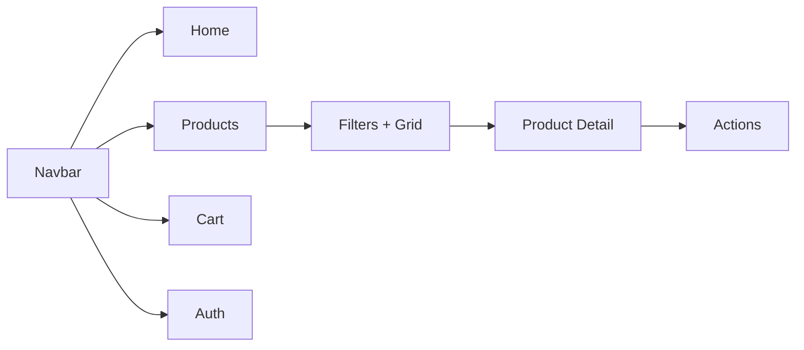

# 5. UI/UX Design

## 5.1 Design Goals
- Clean, minimal interface
- Responsive design (mobile-first)
- Clear product presentation
- Intuitive navigation
- Fast loading

## 5.2 Color Palette
| Color | Hex | Usage |
|---|---|---|
| Primary | `#2563eb` | Buttons, Links |
| Secondary | `#64748b` | Text Secondary |
| Background | `#f8fafc` | Page Background |
| Card | `#ffffff` | Product Cards |
| Accent | `#dc2626` | Alerts/Discounts |

## 5.3 Key UI Components
- Navbar (Search, Nav Links)
- Product Card
- Filter Sidebar
- Product Detail View
- Cart/Wishlist/Compare Views
- Auth Forms

## 5.4 User Interface Flow

## 5.5 Wireframe Concept
- **Home**: Hero + Categories + Featured
- **Products**: Left sidebar filters + right product grid
- **Product Detail**: Image + Info + Specs + Reviews
- **Cart**: Items list + Summary
