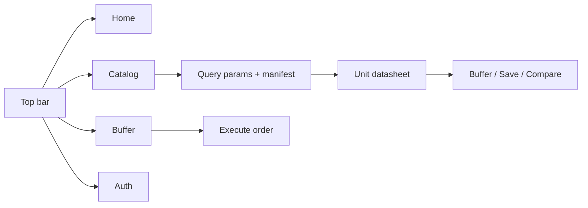

# 5. UI/UX Design

## 5.1 Design Goals
- A distinctive **"lab terminal"** identity — not a generic storefront template
- Dark, high-contrast "phosphor" canvas with a single amber accent
- Monospace-first typography (technical readout feel)
- Motion with intent: reveal, feedback, and atmosphere (never gratuitous)
- Responsive and accessible (keyboard focus states, reduced visual noise on small screens)
- Fast loading; animation only on cheap properties (opacity/transform)

## 5.2 Color Palette

| Token | Hex | Usage |
|---|---|---|
| `bg` | `#07080a` | Page background (near-black) |
| `panel` | `#0c0f12` | Cards / panels |
| `panel-2` | `#101417` | Hover / raised surfaces |
| `line` | `#1c2228` | Hairline borders / dividers |
| `ink` | `#d8dcd4` | Primary text (soft phosphor white) |
| `dim` | `#79837c` | Secondary text |
| `phos` | `#ffb020` | Amber accent — primary actions, brand |
| `sig` | `#3ddc84` | Signal green — success / in-stock |
| `alert` | `#ff5c5c` | Errors / out-of-stock |

## 5.3 Typography & Motifs
- **Body / UI**: JetBrains Mono (300–800)
- **Display accents**: VT323 (brand wordmark, section numerals, big statements)
- Motifs: corner-ticked panels, `[ brackets ]`, `>` prompts, blinking cursor, dotted leaders, CRT scanline + grain overlay, numbered index rows.

## 5.4 Motion System
| Library | Role |
|---|---|
| **Lenis** | Global smooth scrolling (`SmoothScroll` root provider) |
| **Motion (Framer)** | Page transitions, scroll reveals, list stagger, mobile filter drawer (`AnimatePresence`) |
| **GSAP** | Brand marquee loop (`Marquee`), animated metric counters (`CountUp`) |
| Custom rAF | Character-scramble text reveal (`Scramble`) |

## 5.5 Key UI Components
- Terminal top bar (`Navbar`) with command-prompt search and `cmp / sav / buf` counters
- Status ticker + fixed bottom status bar (route, clock, DB readout)
- Unit cell (`ProductCard`) and manifest row (`ProductList`)
- Query parameters panel (`FilterSidebar`), sort, pagination
- Datasheet / price-log / feedback-log sections (`ProductDetail`)
- Buffer, saved units, compare matrix, access terminal (auth), operator console, order log

## 5.6 User Interface Flow

## 5.7 Layout Concept
- **Home**: console hero (scramble headline + system-status readout), brand marquee, numbered category index, featured unit cells
- **Catalog**: query-parameters panel + dense result manifest (index, thumb, specs, price, actions)
- **Unit detail**: framed gallery + datasheet, price log, feedback log + append form, related units
- **Buffer**: line items + invoice panel with dashed rule
- **Compare**: specification diff matrix
