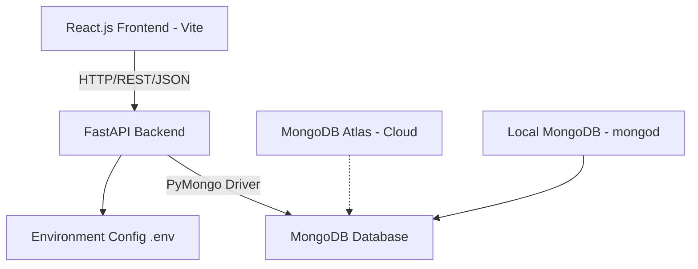
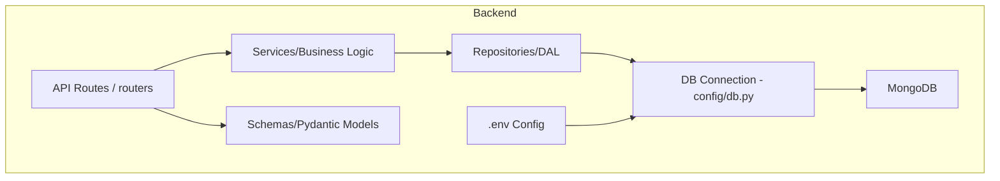
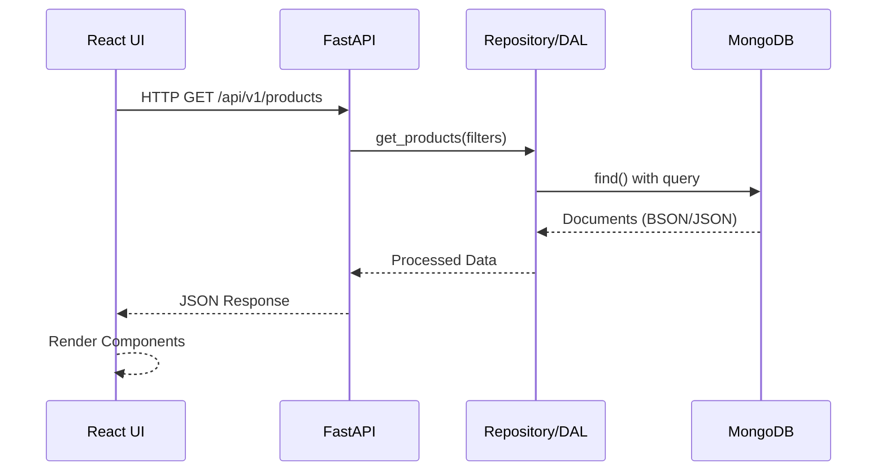

# 6. Software Architecture

## 6.1 Architecture Overview
Full-stack 3-tier architecture with separation of concerns.



## 6.2 Technology Stack

| Layer | Technology | Justification |
|---|---|---|
| Frontend | React.js + Vite + Tailwind CSS | Fast, modern, simple for API integration |
| Backend | FastAPI (Python) | Async, auto docs, clean for MongoDB |
| Database | MongoDB | Document store, flexible schema, demonstrates NoSQL |
| ODM/Driver | PyMongo | Direct control, clear MongoDB usage demonstration |
| API | REST (JSON) | Simple, standard |

## 6.3 Backend Architecture



## 6.4 Project Structure (Planned)

```text
Electronics catalog/
├── backend/
│   ├── app/
│   │   ├── api/v1/         # Route handlers
│   │   ├── core/           # Config, settings
│   │   ├── db/             # MongoDB connection
│   │   ├── models/         # Pydantic schemas
│   │   ├── repositories/   # Data access layer
│   │   ├── services/       # Business logic
│   │   ├── schemas/        # Request/Response models
│   │   ├── utils/          # Helpers
│   │   └── main.py         # FastAPI app
│   ├── .env.example
│   ├── requirements.txt
│   └── seed.py
├── frontend/
│   ├── src/
│   │   ├── components/
│   │   ├── pages/
│   │   ├── services/api.js
│   │   ├── hooks/
│   │   ├── utils/
│   │   └── App.jsx
│   ├── public/
│   └── package.json
├── docs/
├── implementation/
└── README.md
```

## 6.5 Data Flow


