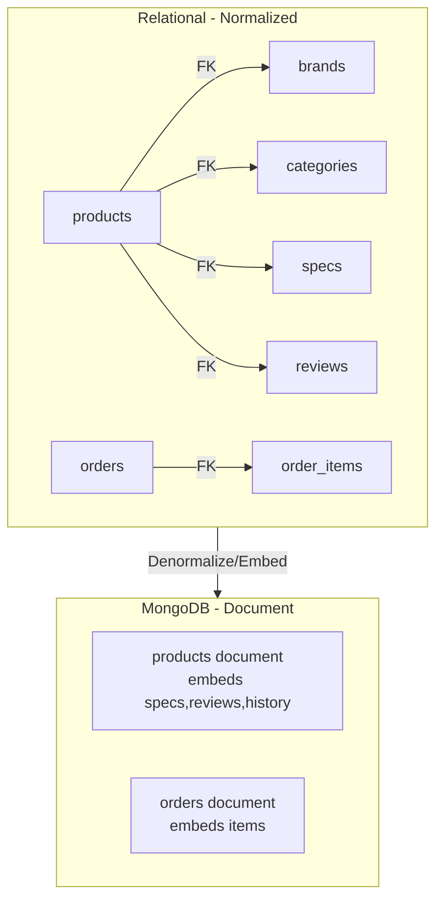

# 7. Database Design (NoSQL - MongoDB)

## 7.1 Design Philosophy
Using MongoDB document model. Focus on:
- Embedding vs Referencing based on access patterns
- Denormalization for read performance
- Flexible schema for product attributes
- Avoiding unnecessary joins

## 7.2 Collections Design

| Collection | Purpose | Rationale |
|---|---|---|
| `products` | Core product data | Main entity, read-heavy |
| `brands` | Brand master | Referenced or embedded? See rationale |
| `categories` | Category master | Referenced or embedded |
| `users` | User accounts | Auth data |
| `orders` | Order history | Transactional, needs integrity |
| `reviews` | Reviews | Can embed in products or separate |
| `carts` | User cart | Session-like, embedded preferred |

## 7.3 Product Document Structure (Example)

```json
{
  "_id": "ObjectId('...')",
  "slug": "samsung-galaxy-s24",
  "name": "Samsung Galaxy S24",
  "brand": { "_id": "ObjectId('...')", "name": "Samsung" },
  "category": { "_id": "ObjectId('...')", "name": "Smartphones" },
  "description": "...",
  "price": 74999,
  "discount_price": 62999,
  "stock": 15,
  "images": ["url1", "url2"],
  "specifications": [
    { "key": "Display", "value": "6.2-inch Dynamic AMOLED" },
    { "key": "RAM", "value": "8 GB" }
  ],
  "reviews": [
    { "user_id": "...", "username": "demo", "rating": 5, "comment": "...", "created_at": "..." }
  ],
  "price_history": [
    { "old_price": 74999, "new_price": 62999, "changed_at": "..." }
  ],
  "average_rating": 4.5,
  "total_reviews": 10,
  "is_active": true,
  "is_featured": true,
  "created_at": "ISODate()",
  "updated_at": "ISODate()"
}
```

## 7.4 Embedding vs Referencing Decision

| Relationship | Approach | Reason |
|---|---|---|
| Product → Specifications | **Embed** | Small array, always shown with product |
| Product → Reviews | **Embed (limited)** or **Reference** | Embed if small count; for ABA embed is fine |
| Product → Price History | **Embed** | Historical, shown on detail page |
| Product → Brand/Category | **Reference + Denormalize** (store name) | Avoid duplication of large brand data, but keep name for display |
| Order → OrderItems | **Embed** | Order is a snapshot; items belong to order |
| User → Cart | **Embed** | Cart is small, per-user view |

## 7.5 Indexing Strategy

| Index | Type | Purpose |
|---|---|---|
| `products.name` | Text/Regular | Search functionality |
| `products.brand._id`, `products.category._id` | Compound/Single | Filtering |
| `products.price` | Single | Price range/sort |
| `products.slug` | Unique | Fast lookup by slug |
| `products.is_active` | Partial | Filter active products |
| `users.email` | Unique | Auth |

## 7.6 ERD vs Document Model Comparison



## 7.7 Local vs Atlas Comparison

| Aspect | Local MongoDB | MongoDB Atlas |
|---|---|---|
| Setup | Install mongod locally | Cloud cluster (free M0) |
| Cost | Free | Free tier available |
| Connectivity | `mongodb://localhost:27017` | SRV URI with auth |
| Security | Basic (local) | IP Whitelist, Users, TLS |
| Use Case | Dev, offline work | Demo, sharing, cloud backup |
| Pros | Fast, no internet, full control | Managed, easy access |
| Cons | Needs local service running | Needs internet, free limits |
