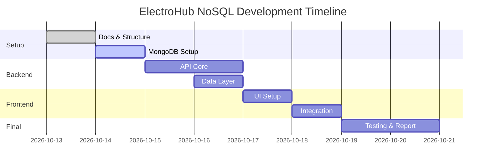

# 9. Development Roadmap

## Phase 1: Setup & Planning (Week 1)
- [x] Project structure setup (backend/frontend/docs)
- [x] Documentation scaffolding
- [ ] MongoDB local installation & testing
- [ ] MongoDB Atlas cluster setup
- [ ] Verify both connections
- [ ] SQL refresher (via ElectroHub review)

## Phase 2: Database Design & Seeding (Week 1-2)
- [ ] Finalize document schema
- [ ] Create seed script for MongoDB
- [ ] Seed sample data (12 products, 4 cats, 8 brands)
- [ ] Verify in Compass/mongosh

## Phase 3: Backend API (Week 2)
- [ ] FastAPI project init in backend/
- [ ] MongoDB connection setup
- [ ] Repositories for Products/Categories/Brands
- [ ] Routes: GET /products, GET /products/{slug}, filters, search
- [ ] Pydantic schemas
- [ ] CORS setup
- [ ] Test with Swagger UI

## Phase 4: Frontend (Week 2-3)
- [ ] Vite React setup in frontend/
- [ ] API service layer (fetch)
- [ ] Components: Navbar, ProductCard, FilterSidebar
- [ ] Pages: Home, Products, ProductDetail
- [ ] Routing
- [ ] Display data from API

## Phase 5: Core Features (Week 3)
- [ ] Search, filters, sort, pagination
- [ ] Reviews display/add (if time)
- [ ] Cart/Wishlist (basic)
- [ ] Auth (optional but nice)

## Phase 6: Testing & Docs (Week 3-4)
- [ ] End-to-end testing
- [ ] Update docs
- [ ] Write report
- [ ] Prepare demo
- [ ] Final review

