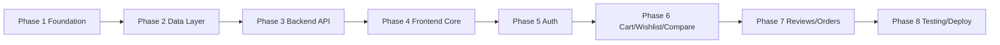

# 9. Development Roadmap (Phase-Based)

> This roadmap is organized by **phases (gates)**, not by calendar weeks.
> Each phase must satisfy its **Exit Criteria** before moving to the next.
> Progress is tracked by checking off tasks.

## Overview

| Phase | Name | Primary Outcome | Status |
|---|---|---|---|
| 1 | Foundation & Environment | Working local/Atlas connections and project scaffolding | ✅ |
| 2 | Data Layer: Modeling, Indexing & Seeding | Document schemas + verified seed data | ✅ |
| 3 | Backend Core: Catalog API | Mountable `/api/v1` read API (products/categories/brands) | ✅ |
| 4 | Frontend Core: Catalog UI | React app browsing real MongoDB data | ✅ |
| 5 | User Accounts & Authentication | Register/login with JWT-protected routes | ✅ |
| 6 | Cart, Wishlist & Comparison | Per-user cart, wishlist, compare up to 4 | ✅ |
| 7 | Reviews, Price History & Checkout | Add reviews, view history, demo order placement | ✅ |
| 8 | Integration, Testing & Polish | End-to-end validation, docs, deployment | ✅ |

---

## Phase 1 — Foundation & Environment Setup

**Goal:** Verified toolchain and connectivity for backend, frontend, and both MongoDB modes.

- [x] Project structure (backend/frontend/docs/implementation)
- [x] Documentation scaffolding (11 docs + API specs)
- [x] Backend venv + `requirements.txt` installs cleanly
- [x] Frontend deps installed; added `axios`, `react-router-dom`, `tailwindcss`, `lucide-react`
- [x] Local MongoDB (`mongod`) reachable via `mongosh`
- [ ] MongoDB Atlas free M0 cluster reachable via SRV URI *(pending real credentials)*
- [x] `ENV=local|atlas` toggle implemented (`Settings.mongo_uri`)
- [x] Replaced stale root `.env.example` with MongoDB stack
- [x] CORS configured for `http://localhost:5173` (plus Vite dev proxy)

**Exit Criteria:** `GET /health` responds, both URI modes selectable, `npm run dev` serves the app.

---

## Phase 2 — Data Layer: Modeling, Indexing & Seeding

**Goal:** Finalized MongoDB document model with realistic, verifiable seed data.

- [x] Finalize collection schemas: `products`, `brands`, `categories`, `users`, `carts`, `wishlists`, `orders`
- [x] Apply embedding decisions (specs/reviews/price_history embedded; brand/category denormalized)
- [x] `seed.py` seeds **12 products**, 4 categories, 8 brands, demo user (hashed password)
- [x] Embedded sample `specifications`, `reviews`, `price_history`, `average_rating`
- [x] Indexes: `slug` unique, `name`, `brand._id`, `category._id`, `price`, `is_active`, `users.email` unique
- [x] Idempotent re-seed (drop/create) and count verification
- [x] Validated structure in `mongosh`

**Exit Criteria:** Seeded counts match, sample product shows nested arrays, indexes present. ✅

---

## Phase 3 — Backend Core: Catalog API

**Goal:** A complete, mounted read-only catalog API with filters, search, sort, and pagination.

- [x] `core/config.py` Pydantic Settings (unused imports removed, `mongo_uri` property)
- [x] `db/mongodb.py` singleton + **lifespan/close hook** in `main.py`
- [x] Fixed Pydantic `_id` fields (aliases) in `schemas/`
- [x] Applied HTTP error handling; proper 404/validation errors
- [x] Repositories: cleaned `ProductRepository` (**dead query block removed**), added category/brand repos
- [x] Routers for products/categories/brands (+ featured, related)
- [x] **Routers registered** with `app.include_router` under `API_V1_PREFIX`
- [x] Search, category/brand filter, price range, sort map, pagination (aggregation pipeline)
- [x] Verified via Swagger (`/docs`) and `curl`

**Exit Criteria:** All read endpoints return correct JSON; filters/search/sort/pagination work; 404 on bad slug. ✅

---

## Phase 4 — Frontend Core: Catalog UI

**Goal:** React app rendering live MongoDB data with routing and a working filter/search experience.

- [x] Configured Tailwind (`@tailwindcss/vite`) + Vite dev proxy to `:8000`
- [x] Layout: `Navbar` (search + links + badges), `Footer`
- [x] `src/services/api.js` axios base (`/api/v1`) + product/category/brand getters
- [x] React Router routes: `/`, `/products`, `/products/:slug`, plus cart/wishlist/compare/auth/orders
- [x] Components: `ProductCard`, `FilterSidebar`, `SearchBar`, `Pagination`, `SortDropdown`, `Rating`
- [x] Pages: `Home` (hero/categories/featured), `Products` (grid + filters), `ProductDetail` (specs/reviews/history)
- [x] Loading, error, and empty states
- [x] Responsive (mobile-first) styling per UI/UX doc

**Exit Criteria:** Products render from API, filtering/search/sort/pagination work end-to-end, no CORS/console errors. ✅

---

## Phase 5 — User Accounts & Authentication

**Goal:** Registration/login with token-based access to protected resources.

- [x] `POST /auth/register`, `POST /auth/login`, `GET /auth/me`
- [x] Passwords hashed (bcrypt) — never plaintext
- [x] JWT issue/verify (`PyJWT`, HS256, configurable expiry)
- [x] `get_current_user` dependency; 401 handling
- [x] User repository + Pydantic auth schemas
- [x] Frontend: `Login`/`Register` pages, token storage, `AuthContext`
- [x] Navbar reflects logged-in state; protected actions prompt login

**Exit Criteria:** Demo user can log in; protected endpoints reject missing/invalid tokens. ✅

---

## Phase 6 — Cart, Wishlist & Comparison

**Goal:** Per-user cart and wishlist persisted in MongoDB, plus product comparison.

- [x] Cart endpoints: `GET /cart`, `POST /cart/add`, `PUT /cart/update`, `DELETE /cart/remove/{id}`, `DELETE /cart/clear`
- [x] Wishlist endpoints: list/add/remove
- [x] Cart stored as embedded items (quantity, snapshot price/name/image)
- [x] Comparison (up to 4) via `CompareContext` (client-side)
- [x] Frontend: `Cart` page (qty/remove/summary), `Wishlist` page, `Compare` table + tray
- [x] Cart/wishlist/compare badges in `Navbar`
- [x] Auth-gated cart/wishlist

**Exit Criteria:** Add/update/remove cart reflects immediately; wishlist toggles; compare limits to 4. ✅

---

## Phase 7 — Reviews, Price History & Checkout

**Goal:** Interactive reviews, price history display, and a demo order flow with stock updates.

- [x] `POST /products/{slug}/reviews` (auth-gated, validates rating 1–5)
- [x] Recomputes `average_rating` / `total_reviews` on add
- [x] Review form on `ProductDetail`
- [x] Price-history section on `ProductDetail`
- [x] Checkout demo: creates `orders` document (embedded items snapshot)
- [x] Decrements `stock`, clears cart on order
- [x] Order history view for logged-in user

**Exit Criteria:** Reviews append and ratings update; demo order creates an order doc and decrements stock. ✅

---

## Phase 8 — Integration, Testing & Polish & Deployment

**Goal:** Fully validated end-to-end application with complete documentation.

- [x] Backend tests (`pytest`) — 23 tests covering products, auth, cart, wishlist, reviews, orders
- [x] Manual API checks for the `docs/10-test-plan.md` cases (TC-001…TC-010)
- [ ] Validate `ENV=atlas` *(pending real Atlas credentials)*
- [x] Loading/error/empty states across pages
- [x] Responsive styling
- [x] Updated README + API spec + roadmap
- [ ] Capture screenshots for the report *(manual step)*
- [x] Local deployment verified (backend :8000, frontend :5173, Swagger `/docs`)
- [x] Final review against BRD success criteria

**Exit Criteria:** All test cases pass (23/23), local environment verified, docs complete, demo-ready. ✅
