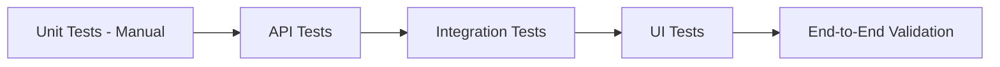

# 10. Test Plan

## 10.1 Testing Objectives
Verify functionality, data integrity, API correctness, and end-to-end flow.

## 10.2 Test Scope
- Product listing, search, filter, sort
- Product detail retrieval
- API endpoints
- Frontend rendering
- MongoDB data operations
- Connection (local/Atlas)

## 10.3 Test Types
- Manual API testing (Swagger/curl)
- Frontend UI testing
- Integration testing (API + DB)
- Data validation

## 10.4 Test Cases

| Test ID | Description | Expected | Status |
|---|---|---|---|
| TC-001 | GET /products returns list | 200 OK, array of products | To Test |
| TC-002 | Search with query returns filtered | Matches name/brand | To Test |
| TC-003 | Filter by category works | Correct subset | To Test |
| TC-004 | Price range filter works | Within range | To Test |
| TC-005 | Sort by price_asc works | Ascending order | To Test |
| TC-006 | GET /products/{slug} valid | 200 with full details | To Test |
| TC-007 | GET /products/{invalid} | 404 Not Found | To Test |
| TC-008 | Frontend loads products | Grid renders | To Test |
| TC-009 | Search from UI works | Results update | To Test |
| TC-010 | MongoDB seeded data present | Correct counts | To Test |

## 10.5 API Test Examples (curl)

```bash
# List products
curl http://localhost:8000/api/v1/products

# Search
curl http://localhost:8000/api/v1/products?q=samsung

# Filter by category
curl http://localhost:8000/api/v1/products?category=smartphones

# Product detail
curl http://localhost:8000/api/v1/products/samsung-galaxy-s24
```

## 10.6 Validation Checklist

- [ ] All required collections exist in MongoDB
- [ ] Seed data matches expected counts
- [ ] API returns correct JSON structure
- [ ] Frontend fetches without CORS errors
- [ ] No console errors
- [ ] Both local and Atlas tested (if configured)


