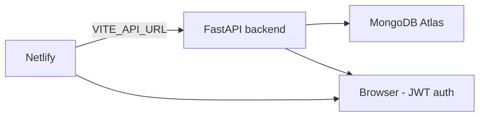

# 12. Netlify Deployment (Frontend)

This project is full-stack. **Netlify hosts only the React frontend** (static build). The FastAPI backend must run on a separate host (Render, Railway, Hugging Face Spaces, a VPS, or any Python host) and MongoDB must be Atlas, since Netlify has no Python runtime.



---

## 12.1 Build Settings (Netlify UI)

In **Site configuration → Build & deploy → Build settings → Edit**, set:

| Field | Value |
|---|---|
| **Base directory** | `frontend` |
| **Build command** | `npm run build` |
| **Publish directory** | `frontend/dist` |
| **Functions directory** | *(leave empty)* |
| **Node version** | `22` (set via Environment variables, see below) |

> These same values are already encoded in [`netlify.toml`](../netlify.toml) at the repo root. If that file is connected, Netlify will auto-apply them and you can leave the UI blank.

### Equivalent UI settings (no `netlify.toml`)

If you prefer not to commit the config file:

| Field | Value |
|---|---|
| Base directory | `frontend` |
| Build command | `npm run build` |
| Publish directory | `dist` |

When a **Base directory** is set, Netlify resolves the publish path relative to it, so use `dist` (not `frontend/dist`) in that case.

---

## 12.2 Environment Variables

Set these under **Site configuration → Environment variables**. They are **build-time** variables — after adding one you must **trigger a new deploy** for it to take effect.

| Key | Scope | Value |
|---|---|---|
| `VITE_API_URL` | **Build** | `https://<your-backend-host>/api/v1` |
| `NODE_VERSION` | **Build** | `22` |

**Important:** `VITE_API_URL` must include the `/api/v1` prefix, because the app uses it as the axios `baseURL` directly:

```js
// frontend/src/services/api.js
const api = axios.create({ baseURL: import.meta.env.VITE_API_URL || '/api/v1' })
```

If you omit it, production requests fall back to the relative path `/api/v1`, which on Netlify resolves to your own site and returns the SPA `index.html` instead of JSON — a classic "API returns HTML" bug.

### How to set `VITE_API_URL`

1. Deploy your backend (see §12.4) and note its base URL, e.g. `https://electrohub-api.onrender.com`.
2. Set `VITE_API_URL = https://electrohub-api.onrender.com/api/v1`.
3. Trigger **Deploy site** again.

---

## 12.3 SPA Routing

The frontend uses `react-router-dom`, so client-side routes like `/products`, `/cart`, `/login` must all fall back to `index.html`. `netlify.toml` already does this:

```toml
[[redirects]]
  from = "/*"
  to = "/index.html"
  status = 200
```

If you are not using `netlify.toml`, create `frontend/public/_redirects` with the single line:

```
/*    /index.html   200
```

Without this, refreshing a deep link (or opening it directly) returns **404**.

---

## 12.4 Backend Prerequisites (must be done first)

The deployed frontend cannot talk to `localhost:8000`. Before (or alongside) the Netlify deploy:

1. **Host the backend** on a public URL (Render/Railway/VPS) running:
   ```bash
   uvicorn app.main:app --host 0.0.0.0 --port $PORT
   ```
2. **Use MongoDB Atlas** — a local MongoDB is not reachable from the cloud. Set `ENV=atlas` and a real `MONGODB_URI_ATLAS`. Run the seed once against Atlas:
   ```bash
   cd backend
   ENV=atlas python seed.py
   ```
3. **Enable CORS** for the Netlify origin. The backend already ships CORS middleware, so just add the domain to `CORS_ORIGINS` on your backend host:
   ```env
   ENV=atlas
   CORS_ORIGINS=["https://your-site.netlify.app"]
   ```
   Add both the `*.netlify.app` URL and your custom domain (if any), e.g. `["https://your-site.netlify.app","https://yourdomain.com"]`.
4. **Set a strong `SECRET_KEY`** (used to sign JWTs) on the backend host — do not leave the dev default.

Verify the backend is reachable before debugging Netlify:
```bash
curl https://<your-backend-host>/health
curl "https://<your-backend-host>/api/v1/products/?limit=1"
```

---

## 12.5 Connect & Deploy

1. Push the repo to GitHub/GitLab/Bitbucket.
2. In Netlify: **Add new site → Import an existing project** → pick the repo.
3. Netlify auto-detects the root `netlify.toml` and picks up base/build/publish. Confirm in **Build settings**.
4. Add the Environment variables from §12.2.
5. **Deploy site**.
6. After the first deploy, open the site and check the browser console + Network tab for API calls returning JSON (not HTML).

---

## 12.6 Post-Deploy Checklist

- [ ] `/` loads with the terminal UI, no console errors
- [ ] `/products` lists seeded units (proves `VITE_API_URL` + Atlas seeding)
- [ ] Deep-link refresh works: open `/products` directly → no 404 (SPA redirect)
- [ ] Search/filter/sort/pagination return data
- [ ] Register + login return a token; `/account` renders
- [ ] Add to buffer, wishlist, compare all work while logged in
- [ ] Place a demo order → `/orders` shows it
- [ ] `curl https://<backend>/health` returns `{"status":"ok"}`

---

## 12.7 Troubleshooting

| Symptom | Cause | Fix |
|---|---|---|
| API returns an HTML page instead of JSON | `VITE_API_URL` unset or missing `/api/v1` | Set it and rebuild |
| `CORS` errors in console | Netlify origin not in `CORS_ORIGINS` | Add the domain, redeploy backend |
| Deep link 404s on refresh | Missing SPA redirect | Add `netlify.toml` or `_redirects` |
| Build fails on `node-gyp`/native deps | Wrong Node version | Set `NODE_VERSION=22` |
| Empty catalog on live site | Atlas not seeded / `ENV` not `atlas` | Run `ENV=atlas python seed.py` |
| Auth/token errors in prod | Dev `SECRET_KEY` reused | Set a unique `SECRET_KEY` on the backend |

---

## 12.8 Alternative: One-Site Deploy (Netlify + serverless proxy)

If you only want the demo frontend live and cannot host the API, the only supported alternative is to **split the DB layer** (Netlify hosts static; data served from a managed Atlas Data API). This project's FastAPI logic (auth, cart, orders) is not serverless-ready, so **a separate backend host is the recommended path**.
