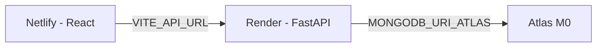

# 13. Backend Host + MongoDB Atlas

The FastAPI backend cannot run on Netlify, so it goes to a separate Python host paired with **MongoDB Atlas**. Recommended free path: **Render** (host) + **Atlas M0** (DB). Railway is a drop-in alternative — the env vars and start command are identical.



---

## 13.1 Create the Atlas database

1. Sign in at [cloud.mongodb.com](https://cloud.mongodb.com) → **Create a project** → build a **Database (M0 Free)**.
2. Under **Database Access → Add New Database User**:
   - Authentication: **Password**
   - Username e.g. `electrohub_app`, generate a strong password (save it).
   - Built-in role: **Read and write to any database** (or scope it to `electrohub_nosql`).
3. Under **Network Access → Add IP Address** → **0.0.0.0/0** (Allow access from anywhere).
   - Required for Render, whose egress IPs rotate. Acceptable for a demo project; for anything real, restrict it.
4. **Deployments → Connect → Drivers** and copy the **SRV connection string**.

Build the URI like this (replace `<user>`, `<password>`, `cluster0.xxxx`):

```
mongodb+srv://electrohub_app:<password>@cluster0.xxxx.mongodb.net/electrohub_nosql?retryWrites=true&w=majority
```

> **URL-encode special characters in the password.** `@` → `%40`, `:` → `%3A`, `/` → `%2F`, `%` → `%25`, `#` → `%23`. A raw `@` in the password makes the URI parse as the wrong host.

**Verify it before deploying** (from your machine):

```bash
cd backend
# temporarily set in .env:
#   ENV=atlas
#   MONGODB_URI_ATLAS=mongodb+srv://...?retryWrites=true&w=majority
python seed.py            # loads 12 products / 4 categories / 8 brands
```

Then check the Atlas **Collections** tab — you should see `products`, `categories`, `brands`, `users`, `orders`.

---

## 13.2 Deploy the backend to Render

1. Push the repo to GitHub.
2. [dashboard.render.com](https://dashboard.render.com) → **New → Web Service** → connect the repo.
3. Configure:

| Field | Value |
|---|---|
| Name | `electrohub-api` |
| Runtime | **Python 3** |
| Root Directory | `backend` |
| Build Command | `pip install -r requirements.txt` |
| Start Command | `uvicorn app.main:app --host 0.0.0.0 --port $PORT` |
| Instance Type | Free (spins down when idle) or Starter |

> A `backend/.python-version` file pins Python **3.12** — Render picks it up automatically.

4. Add the **Environment Variables** (below), then **Create Web Service**.
5. Wait for the deploy to go green and note the URL, e.g. `https://electrohub-api-xxxx.onrender.com`.

### Environment variables (Render → Environment tab)

| Key | Value |
|---|---|
| `ENV` | `atlas` |
| `MONGODB_URI_ATLAS` | `mongodb+srv://electrohub_app:<password>@cluster0.xxxx.mongodb.net/electrohub_nosql?retryWrites=true&w=majority` |
| `MONGODB_DB_NAME` | `electrohub_nosql` |
| `API_V1_PREFIX` | `/api/v1` |
| `SECRET_KEY` | a long random string (64+ chars) — signs JWTs |
| `ACCESS_TOKEN_EXPIRE_MINUTES` | `1440` |
| `CORS_ORIGINS` | `["https://your-site.netlify.app"]` |

`CORS_ORIGINS` is a **JSON array**. Include your Netlify domain *and* any custom domain:

```
["https://your-site.netlify.app","https://yourdomain.com"]
```

Set a real `SECRET_KEY` — the dev default will invalidate every logged-in session if changed later.

### Verify

```bash
curl https://electrohub-api-xxxx.onrender.com/health
# {"status":"ok","env":"atlas"}

curl "https://electrohub-api-xxxx.onrender.com/api/v1/products/?limit=1"
# {"items":[...], ...}   <-- must be JSON, not HTML
```

> **Free tier note:** the instance sleeps after inactivity, so the first request after idle takes ~50s (cold start). The health check (`/health`) and Netlify both tolerate this; click around once to warm it before a demo.

---

## 13.3 Connect the two ends

**On Netlify** — set the build-time var so the frontend calls your Render URL (must include `/api/v1`):

```
VITE_API_URL = https://electrohub-api-xxxx.onrender.com/api/v1
```

**On Render** — `CORS_ORIGINS` must list the Netlify domain.

Then **redeploy both** (env vars are picked up at build time on Netlify and on restart on Render). Full frontend steps: [12. Netlify Deployment](12-netlify-deployment.md).

---

## 13.4 Deployment options at a glance

| Host | Free tier | Start command | Notes |
|---|---|---|---|
| **Render** ✅ | Yes (sleeps) | `uvicorn app.main:app --host 0.0.0.0 --port $PORT` | Easiest for this repo; Root Dir `backend` |
| Railway | Credits/trial | `uvicorn app.main:app --host 0.0.0.0 --port $PORT` | No sleep; Root Directory `backend` |
| Fly.io | Yes (small) | `uvicorn app.main:app --host 0.0.0.0 --port $PORT` | Needs `fly.toml` / `fly launch` |
| PythonAnywhere | Free (limited) | WSGI: `app.main:app` | Manual, no auto-deploy |

---

## 13.5 Troubleshooting

| Symptom | Cause | Fix |
|---|---|---|
| `ConfigurationError: MONGODB_URI_LOCAL...` | `ENV` not `atlas` | Set `ENV=atlas` on the host |
| `Authentication failed` | Wrong user/pass or bad password encoding | Recreate the DB user; URL-encode the password |
| `ServerSelectionTimeoutError` | IP not allowed | Network Access → `0.0.0.0/0` |
| CORS error in browser | Netlify domain missing from `CORS_ORIGINS` | Add it as JSON array item, redeploy backend |
| `/api/v1/products/` returns HTML | `VITE_API_URL` unset on Netlify | Set it + redeploy frontend |
| Catalog empty on live | Atlas never seeded | `cd backend && ENV=atlas python seed.py` |
| Every user logged out after deploy | `SECRET_KEY` changed | Set one stable value and keep it |
