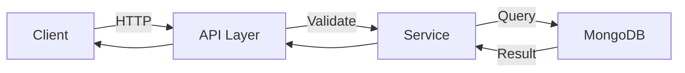

# API Specification (Markdown)

## Base URL
`http://localhost:8000/api/v1`

## 1. Products

### GET /products
List products with search/filter/sort/pagination.

**Query Params:**
| Param | Type | Required | Description |
|---|---|---|---|
| q | string | No | Search by name/brand/desc |
| category | string | No | Filter by category ID/name |
| brand | string | No | Filter by brand |
| min_price | number | No | Min price |
| max_price | number | No | Max price |
| sort | string | No | price_asc\|price_desc\|rating_desc\|newest |
| page | int | No | Default 1 |
| limit | int | No | Default 12 |

**Response (200):**
```json
{
  "items": [...],
  "total": 12,
  "page": 1,
  "limit": 12
}
```

### GET /products/{slug}
Get single product details.

**Path:** `slug` (string)

**Response (200):** Product with specs, reviews, price_history

## 2. Categories

### GET /categories
List all categories

## 3. Brands

### GET /brands
List all brands

## 4. Auth (Planned)

### POST /auth/register
Register new user
### POST /auth/login
Login user (return token/session)

## 5. Cart (Planned)

### GET /cart
Get current cart
### POST /cart/add
Add item to cart
### PUT /cart/update
Update quantity
### DELETE /cart/remove/{id}
Remove item

## 6. Reviews (Planned)

### POST /products/{id}/reviews
Add review


