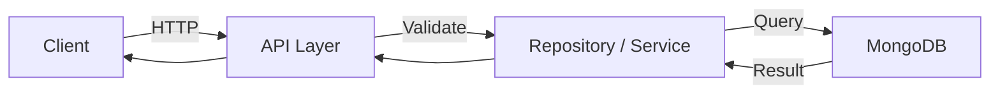

# API Specification (Markdown)

## Base URL
`http://localhost:8000/api/v1`

All list endpoints return JSON. Protected endpoints require an
`Authorization: Bearer <token>` header.

## 1. Products

### GET /products
List active products with search/filter/sort/pagination.

**Query Params:**
| Param | Type | Required | Description |
|---|---|---|---|
| q | string | No | Search by name/brand/category/description/specs |
| category | string | No | Filter by category slug or name |
| brand | string | No | Filter by brand slug or name |
| min_price | number | No | Min effective price |
| max_price | number | No | Max effective price |
| sort | string | No | `price_asc` \| `price_desc` \| `rating_desc` \| `newest` (default `newest`) |
| page | int | No | Default 1 |
| limit | int | No | Default 12 (max 50) |

**Response (200):**
```json
{ "items": [ { "_id": "...", "name": "...", "slug": "...", "price": 74999,
  "discount_price": 62999, "average_rating": 4.5, "brand": {"name": "Samsung"},
  "category": {"name": "Smartphones"} } ], "total": 12, "page": 1, "limit": 12 }
```

### GET /products/{slug}
Get a single product with `description`, `specifications`, `reviews` and `price_history`.
Returns **404** if not found.

### GET /products/featured?limit=8
Featured, active products sorted by rating.

### GET /products/{slug}/related?limit=4
Other active products in the same category.

### POST /products/{slug}/reviews  *(auth required)*
Add a review and recompute `average_rating` / `total_reviews`.

**Body:** `{ "rating": 1-5, "comment": "..." }`

## 2. Categories & Brands

### GET /categories
List categories with a `product_count`.

### GET /brands
List brands with a `product_count`.

## 3. Auth

### POST /auth/register
Register a new user (passwords stored hashed with bcrypt).
**Body:** `{ "name", "username", "email", "password" }`
**Response (201):** `{ "access_token", "token_type": "bearer", "user": {...} }`

### POST /auth/login
**Body:** `{ "email", "password" }` → same token response.
Returns **401** on invalid credentials.

### GET /auth/me  *(auth required)*
Returns the current user.

## 4. Cart *(auth required)*

| Method | Path | Body | Description |
|---|---|---|---|
| GET | /cart | – | Cart with items + `subtotal`, `discount`, `total`, `count` |
| POST | /cart/add | `{ product_id, quantity }` | Add (capped by stock) |
| PUT | /cart/update | `{ product_id, quantity }` | Update qty (0 removes) |
| DELETE | /cart/remove/{product_id} | – | Remove item |
| DELETE | /cart/clear | – | Empty cart |

## 5. Wishlist *(auth required)*

| Method | Path | Body | Description |
|---|---|---|---|
| GET | /wishlist | – | List saved products |
| POST | /wishlist/add | `{ product_id }` | Add product |
| DELETE | /wishlist/remove/{product_id} | – | Remove product |

## 6. Orders *(auth required)*

### POST /orders
Create a demo order from the current cart: validates stock, decrements stock,
clears the cart, stores an items snapshot. Returns **400** if the cart is empty.

### GET /orders
List the current user's orders (newest first).

## 7. Health

### GET /health → `{ "status": "ok", "env": "local" }`
### GET / → API banner

## Error Responses

| Code | Meaning |
|---|---|
| 400 | Bad request (e.g. duplicate email, empty cart, insufficient stock) |
| 401 | Missing/invalid token or credentials |
| 404 | Resource not found |
| 422 | Request validation error |


