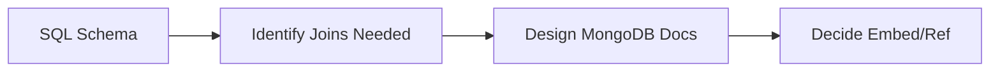

# Implementation Plan - 01: SQL Refresher (Just-in-Time)

## Objective
Quickly recall SQL concepts using existing ElectroHub schema to bridge to NoSQL.

## Time: 1-2 Hours Max

## Steps

1. **Review Models**
   - Read original `models.py` (if available in backup) or recall
   - Identify entities: Product, Brand, Category, Review, Order, OrderItem

2. **Identify Relationships**
   - FK analysis: Product.brand (M:1), Order -> OrderItems (1:M)
   - Understand why OrderItem is separate

3. **Conceptual Queries**
   - Get products with brand name
   - Get order with all items
   - Get product + reviews
   - Filter by price/category

4. **Bridge to NoSQL**
   - For each join case, ask: Embed or Reference?
   - Understand normalization vs denormalization

5. **Key Takeaways**
   - SQL: Normalized, uses JOINs, ACID
   - MongoDB: Denormalized, embedded docs, flexible

