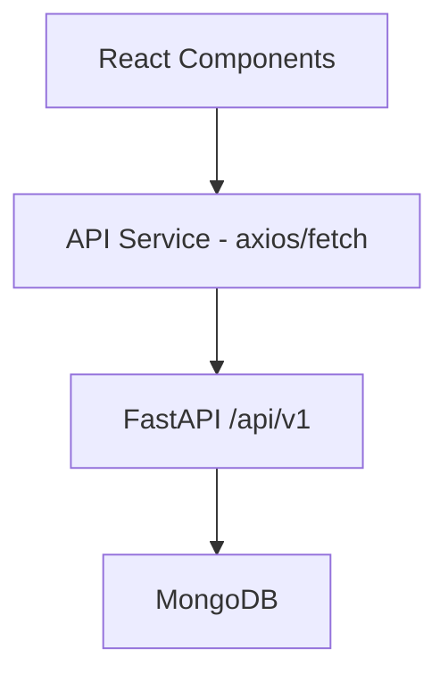

# Implementation Plan - 05: React + Vite Frontend

## Objectives
- Setup Vite React
- API integration layer
- Core pages/components
- Display data from MongoDB

## Tasks

1. **Initialize**
```bash
cd frontend
npm create vite@latest . -- --template react
npm i
npm i axios react-router-dom lucide-react
npm i -D tailwindcss @tailwindcss/vite
```

2. **Configure Tailwind/Vite**
- Add @tailwindcss/vite plugin

3. **Structure**
- src/services/api.js (axios base)
- src/components/ (Navbar, ProductCard, FilterSidebar)
- src/pages/ (Home, Products, ProductDetail, Cart)
- src/hooks/, utils/

4. **API Service**
- Base URL: http://localhost:8000/api/v1
- getProducts, getProductBySlug, getCategories, getBrands

5. **Routing**
- React Router: /, /products, /products/:slug

6. **Pages**
- Products: list + filters + search + sort + pagination
- ProductDetail: full info + specs + reviews
- Home: basic

7. **Test**
- Fetch works, render products
- No CORS errors


